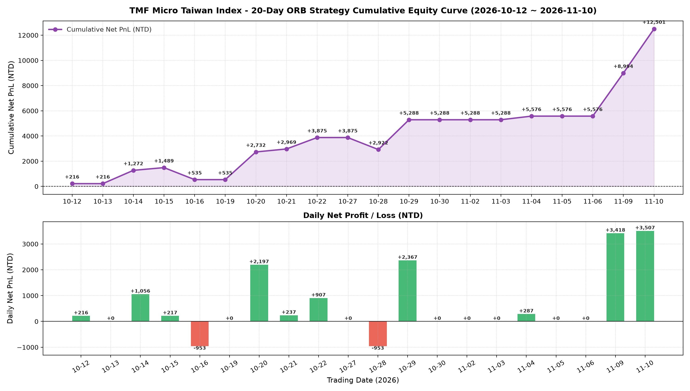

# TMF 微型臺指期 當沖量化交易系統 (ORB Pro V2)

專為臺灣期貨交易所 **微型臺指期 (TMF)** 設計的日內當沖量化交易與回測系統，支援永豐金證券 **Shioaji API** 模擬與正式實盤自動下單。

---

## 一、核心策略特色 (ORB Pro V2 翻修獲利版)

1. **現貨開盤區間突破 (09:00 ~ 09:15 Spot-Open ORB)**：
   - 避開 08:45~09:00 期貨單獨開盤、09:00 台股現貨開盤瞬間的洗盤假突破，以 **09:00 ~ 09:15（現貨開盤首 15 分鐘）** 的最高/最低價為當日多空分水嶺。
2. **法人雙重順勢濾網 (VWAP + EMA9/EMA21)**：
   - **做多條件**：向上突破 ORB 上界 + `收盤價 > VWAP（日內均量成本線）` + `EMA9 > EMA21`。
   - **做空條件**：向下跌破 ORB 下界 + `收盤價 < VWAP` + `EMA9 < EMA21`。
3. **四階梯動態保本鎖利與 60日動態基準 ATR 自適應 (4-Tier Profit Lock + 20d/60d Dynamic ATR Scaling)**：
   - **動態波動倍率 (`ratio`)**：每日依 `前 20 日短期 ATR / 前 60 日長期基準 ATR` 自動縮放各階點位（淘汰寫死的固定分母）。
   - **初始停損**：基準 **-90 點**（具 90 點保底機制，高波動時自動等比放大保護，低波動時不縮小防洗盤）。
   - **一階保本鎖利**：基準浮動獲利達 **+80 點** 時，停損移至 **進場價 +30 點**（確保獲利單絕不變虧損單）。
   - **中階 (1.5階) 保本鎖利**：基準浮動獲利達 **+160 點** 時，停損上移至 **進場價 +100 點**。
   - **二階波段鎖利**：基準浮動獲利達 **+200 點** 時，停損上移至 **進場價 +120 點**。
   - **三階大波段移動停利**：基準浮動獲利達 **+280 點** 啟動移動停利（基準回撤 60 點平倉），否則抱至 **13:08 收盤前安全平倉**。
4. **早盤假突破反手機制 (Stop & Reverse, SAR)**：
   - 若 11:00 前首筆突破單觸發初始停損，且收盤價已反向越過 VWAP（確認早盤為假突破），立即反手進場順應真趨勢（每日最多反手 1 次）。
5. **13:08 ~ 13:10 收盤前極致三道平倉保護**：
   - 提前於 **13:08:00** 策略平倉、**13:09:00** 市價底線補平、**13:10:00** 確認零部位收工，完全避開每月第三個週三結算日 **13:15** 當沖強制代沖銷、13:30 停止撮合與台股現貨尾盤甩尾風險。

---

## 二、20 個交易日回測績效 (2026-10-08 ~ 2026-11-09)

- **獲利天數 / 虧損天數 / 觀望**：**10 勝 / 2 負 / 8 觀望（有交易日勝率 83.3%）**
- **單筆交易勝率 (Win Rate)**：**83.3%（12 筆中 10 勝 2 負）**
- **累積總獲利點數**：**+985 點**
- **扣除成本總淨損益 (含手續費、期交稅、滑價)**：**+NT$ 9,210 元 / 口**
- **獲利因子 (Profit Factor)**：**5.83**
- **最大區間回撤 (MDD)**：**NT$ 953 元**



---

## 三、專案目錄結構

```text
tmf_daytrading/
├── .env.example                # 永豐金 Shioaji API 金鑰設定範本
├── config.py                   # 商品規格、API 設定與 ORB Pro 策略參數
├── main.py                     # 系統主入口 (支援 backtest / paper / live 模式)
├── run_backtest.py             # 單一交易日回測腳本
├── run_10days_backtest.py      # 前 10 個交易日回測腳本
├── run_20days_backtest.py      # 前 20 個交易日回測腳本
├── strategies/                 # 策略邏輯庫
│   ├── orb_strategy.py         # ORB Pro V2 主力策略 (含 VWAP/EMA、三階鎖利、SAR)
│   └── dual_ema_strategy.py    # 雙均線 + VWAP 順勢策略模板
├── backtester/                 # 回測核心引擎
│   ├── engine.py               # 1分K合成與逐根回測引擎
│   └── metrics.py              # 績效統計器 (含手續費、稅、滑價與 MDD 計算)
├── live/                       # 實盤/模擬下單模組
│   └── shioaji_trader.py       # 永豐 Shioaji 自動看盤、下單與 13:25 安全平倉機器人
└── data/
    └── tmf_20days_1m_kbars.csv # 20 個交易日 1分K 輕量快取檔 (克隆後可立即秒級回測)
```

---

## 四、快速安裝與使用指南

### 1. 安裝套件與設定金鑰
```bash
pip install -r requirements.txt
cp .env.example .env
# 編輯 .env 填入您的 SHIOAJI_API_KEY 與 SHIOAJI_SECRET_KEY
```

### 2. 執行歷史回測 (無需 API Key)
```bash
# 執行前 20 個交易日回測
python3 run_20days_backtest.py

# 執行前 10 個交易日回測
python3 run_10days_backtest.py
```

### 3. 開盤日啟動自動交易機器人 (建議 08:40 ~ 08:45 啟動)
```bash
# 模式 A：永豐 Shioaji 模擬環境試跑 (simulation=True，不下真單)
python3 main.py --mode paper --contract 202611 --qty 1

# 模式 B：永豐 Shioaji 正式實盤自動下單 (simulation=False，需設定 .env 內憑證路徑)
python3 main.py --mode live --contract 202611 --qty 1
```

---

## 五、成交確認、部位對帳與斷線重啟保護 (實盤高可靠度架構)

### 1. 單一真實依據 (Single Source of Truth)
期貨當沖交易以**永豐金期貨帳戶實際結算部位 (`list_positions`)** 為最高依據，絕不單憑本地記憶體猜測。

### 2. 斷線與中途重啟保護 (Crash Recovery & Position Adoption)
如果交易途中 **Terminal 視窗關閉、網路短暫中斷或電腦重開**：
- **自動接管真實部位**：重新啟動程式 (`python3 main.py --mode live`) 時，機器人自動透過 Shioaji 查詢帳上真實持倉。若帳上有多單或空單，機器人**立即自動接管**該部位，以券商真實成交成本價重新掛載停損 (-90點)、三階梯保本鎖利與 13:08 強制平倉風控！
- **歷史 K 棒防重複下單**：盤中重啟時，會自動將當日前段已收盤的 K 棒標記為已處理，**絕不會重播歷史早盤訊號而重複開倉**，僅從當前最新即時行情開始監控。
- **狀態即時快照**：盤中自動同步將最高浮盈、交易次數與進場時間儲存至 `logs/state_YYYYMMDD.json`，重啟時無縫接續追蹤最高浮損益。
- **手動平倉同步**：若你在手機 App (大戶投 / iLeader) 手動將部位平倉，機器人下次對帳時會偵測到帳上部位已歸零，自動將策略拉回空手狀態，防止後續誤平倉。
- **13:08 ~ 13:10:00 提前收盤與絕不留倉底線**：
  1. `13:08:00`：第一道策略強制平倉（避開結算日 13:15 當沖強平、現貨尾盤集合競價與結算甩尾）。
  2. `13:09:00`：第二道底線強制補平（若帳上仍有殘留部位，直接送出 MKP 市價 IOC 單強制補平）。
  3. `13:10:00`：第三道安全退出（確認帳上淨部位為 0，完成收盤檢查並進入待機模式）。

### 3. 成交確認與異常防護
每張單送出後，程式不會假設「送出 = 成交」，而是：
- **輪詢直到 Filled**：每張單送出後輪詢委託狀態直到成交，取得實際成交均價與口數；逾時 (10 秒) 仍掛在市場上立即自動撤單。
- **開倉未成交**：策略退回空手；連續 3 次未成交則自動觸發停開新倉保護。
- **平倉未成交**：若平倉單未成交，自動反覆補平 (最多重試 3 次)，失敗時發出 CRITICAL 警告並停止開新倉。
- **進場價校正**：開倉成功後，策略停損與鎖利基準自動校正為**券商真實成交均價**，而非回測用的收盤價。
- **稽核紀錄**：每筆委託與對帳結果即時寫入 `logs/orders_YYYYMMDD.csv`。

### 4. 推薦背景常駐執行方式 (防止關閉終端機中斷)
建議使用 `tmux` 或 `nohup` 執行，即便關閉 Terminal 視窗或 SSH 斷線，交易程式仍會在背景持續運作：

```bash
# 方法 A：使用 tmux (推薦)
tmux new -s tmf_trader
python3 main.py --mode live --contract 202611 --qty 1
# 離開視窗可按 Ctrl+B 再按 D (Detach)；隨時可用 tmux attach -t tmf_trader 回來查看

# 方法 B：使用 nohup 背景執行
nohup python3 main.py --mode live --contract 202611 --qty 1 > logs/trader.log 2>&1 &
```

---

## 六、自動化單元測試

專案包含完整的模擬券商行為單元測試（涵蓋全部成交、未成交撤單、部分成交、卡單、手動平倉對齊、重啟接管多空單、最高浮盈恢復、歷史 K 棒過濾與 13:22 強制補平），**不需要 API Key** 即可直接驗證：

```bash
python3 tests/test_live_verification.py
```
